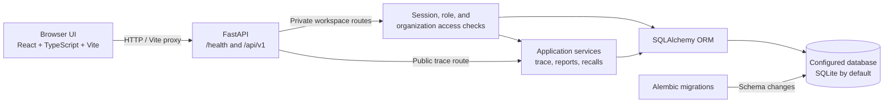

# 🛡️ FoodTrace Sentinel

**Trace Every Batch. Detect Every Gap. Recall with Precision.**

FoodTrace Sentinel is a food-batch traceability and recall decision-support prototype. It connects organization, product, batch, event, and genealogy records so teams can review recorded supply-chain history and investigate a potential recall.

**Repository:** [github.com/TusharAmrutkar26/FoodTrace-Sentinel](https://github.com/TusharAmrutkar26/FoodTrace-Sentinel)

*Jump to: [Features](#-key-features) · [Workflow](#-how-it-works) · [Architecture](#-architecture) · [Getting started](#-getting-started) · [Testing](#-testing) · [Team](#-team-sutra)*

## 🌾 The Problem & Our Solution

Food batch information can be spread across suppliers, processors, and distributors, making it difficult to follow a batch and understand which records support its history. FoodTrace Sentinel brings those records into one workspace, connects batches through explicitly recorded events and genealogy, surfaces rule-based data findings, and helps people review a possible recall scope. It supports investigation; it does not guarantee food safety or prevent all fraud.

## ✨ Key Features

| Feature | What it does | Business value |
| --- | --- | --- |
| Organization, product, and batch records | Manage catalog records and create or update permitted batch details with exact decimal quantities. | Makes batch information easier to find and maintain. |
| Events and genealogy | Record chronological events and explicit parent-to-child split, merge, and transformation links. | Helps teams follow recorded handoffs and batch lineage. |
| QR public trace pages | Open a privacy-filtered trace page using a stable opaque batch identity. | Provides a convenient way to look up the record associated with a batch QR. |
| TraceTrust findings | Recompute deterministic, explainable checks against saved quantities, units, and genealogy. | Brings recorded inconsistencies and evidence gaps to reviewers' attention. |
| Supply-chain reports | View date-filtered activity aggregates and export the report as CSV. | Helps operations teams review recorded activity for a selected period. |
| Recall simulator and incidents | Traverse recorded genealogy to propose candidate scope; save snapshots, human decisions, history, and follow-up actions. | Supports structured, evidence-based recall investigation. |
| Authentication and access control | Use invitation-based accounts, revocable sessions, roles, CSRF checks, and organization-scoped access. | Restricts private workspace data to authorized accounts. |
| English, Hindi, Marathi, and themes | Switch interface language and light/dark appearance; preferences persist in the browser. | Makes the workspace more adaptable to user preference. |

## 🏢 Who Benefits?

Potential users include food producers and processors, suppliers and distributors, quality-assurance teams, warehouse and operations teams, and recall coordinators. The workspace can make batch lookup easier, clarify which traceability records are available, surface recorded data gaps, and support better-informed investigations. No quantified business impact has been measured.

## 🔄 How It Works

1. Administrators set up organizations and products; authorized users register batches.
2. Users record supply-chain events and explicit relationships between batches.
3. A user opens a batch in the workspace or follows its QR trace link.
4. The workspace presents recorded history and current TraceTrust findings.
5. A user simulates candidate recall scope and reviews its paths and evidence.
6. An authorized user records an incident decision and tracks follow-up actions.

## 🏗️ Architecture



The React frontend calls the FastAPI service through JSON endpoints; during development, Vite proxies API requests to the backend. FastAPI applies session and access checks to workspace routes, while health and opaque-ID public trace routes remain unauthenticated. Application services use SQLAlchemy to read and write the configured database, and Alembic manages schema changes.

## 🧰 Tech Stack

- **Frontend:** React, TypeScript, Vite, CSS, Vitest, and Testing Library.
- **Backend:** Python, FastAPI, Pydantic, SQLAlchemy, and Alembic.
- **Data:** SQLite by default, with the database selected by `DATABASE_URL`.
- **Security and QR:** Argon2id password hashing, revocable server-side sessions, and the `qrcode` library.
- **Verification:** pytest, Vitest, and the TypeScript compiler.

## 📂 Project Structure

```text
frontend/
  src/
    App.tsx, auth.tsx, i18n.tsx, theme.tsx
    components/       Workspace, batch, trace, report, and recall views
    lib/              API client, proxy helpers, and CSV exports
    types/            API request and response types
backend/
  app/
    api/v1/           FastAPI routes
    core/             Configuration and authentication dependencies
    db/               SQLAlchemy metadata, engine, and sessions
    models/            Database models
    schemas/           Pydantic validation and response schemas
    services/          Batch, trace, report, and recall logic
    scripts/           Admin bootstrap and fictional demo data
  alembic/versions/   Forward database migrations
  tests/              Isolated API, service, and migration tests
README.md
```

## 🚀 Getting Started

### Prerequisites

- Windows PowerShell
- Python 3.10 or newer
- Node.js 22.12 or newer and npm
- Git

### Backend

From the repository root, open a PowerShell terminal and run:

```powershell
Set-Location .\backend
py -m venv .venv
.\.venv\Scripts\python.exe -m pip install -r requirements.txt
if (-not (Test-Path .env)) { Copy-Item .env.example .env }
```

Before migrating, review `DATABASE_URL` in `backend/.env` and confirm it selects the development database you intend to use. The example uses SQLite. Keep any existing `.env` file and its credentials; the copy command above only creates one when it is absent.

Apply the migrations, create the first platform administrator, then start the API:

```powershell
.\.venv\Scripts\python.exe -m alembic upgrade head
.\.venv\Scripts\python.exe -m app.scripts.bootstrap_admin --email admin@example.com
.\.venv\Scripts\python.exe -m uvicorn app.main:app --reload --host 127.0.0.1 --port 8000
```

The bootstrap script prompts for the administrator password and stores only its hash. Replace the example email with the administrator's account. Once signed in, an administrator can issue an invitation; the app does not send invitation email.

### Frontend

In a second PowerShell terminal from the repository root:

```powershell
Set-Location .\frontend
npm install
npm run dev
```

The Vite server binds to the local network interface. The usual local URLs are:

- App: <http://localhost:5173>
- API health: <http://127.0.0.1:8000/health>
- Interactive API docs: <http://127.0.0.1:8000/docs>

The API proxy targets `http://127.0.0.1:8000` by default. Keep `VITE_API_BASE_URL` empty for local development. If FastAPI uses another port, set `VITE_API_PROXY_TARGET` in `frontend/.env.local` and restart Vite.

### QR access from a phone

QR endpoints require a configured public frontend origin. In `backend/.env`, set `PUBLIC_TRACE_BASE_URL` to the address and port your phone can reach, for example `http://<your-laptop-lan-ip>:5173`; replace the placeholder with your laptop's current LAN address. Add the same exact origin to `FRONTEND_ORIGINS`. Vite reads the configured port, binds for LAN access, and refuses to silently choose a different port. Restart both servers after changing these settings. Leave `VITE_API_BASE_URL` empty so the phone uses the Vite API proxy. If a firewall blocks access, allow only the selected Vite port on the private network; do not disable the firewall.

## 🧪 Testing

The last verified baseline is commit `8ba802ef2572cc80200e9efdd0fae908805734d0`: backend **110 passed** (one Starlette deprecation warning), frontend **78 passed across 10 files**, TypeScript check passed, and production build passed with a large JavaScript chunk advisory. These are test results from that baseline, not a claim that continuous integration runs automatically.

Run the backend suite from `backend`:

```powershell
.\.venv\Scripts\python.exe -m pytest
```

Run the frontend tests, type check, and production build from `frontend`:

```powershell
node .\node_modules\vitest\vitest.mjs run --configLoader native --pool=threads --maxWorkers=1 --reporter=dot
node .\node_modules\typescript\bin\tsc -b
node .\node_modules\vite\bin\vite.js build --configLoader native
```

## 🔐 Important Notes

- Do not commit real credentials from `.env` files. Keep secrets out of source control.
- Review the configured database and back it up before applying migrations to existing data.
- A QR code links to a system record; it does not prove that a physical product or package is authentic.
- A missing record or TraceTrust finding is a prompt to investigate, not proof of contamination or fraud. No unit conversions or incompatible quantity totals are inferred.
- Recall simulation produces candidate scope for human review. An incident decision is a workflow record, not an official recall declaration or proof of contamination.
- Names entered for assignees and historical actors are not verified identities. New incident creator and reviewer attribution uses the signed-in account.
- Public trace pages omit private event notes and internal database IDs; only record information appropriate for public display.

## 🗺️ Roadmap

- **Planned:** Sentinel AI conversational assistant grounded in data the signed-in user is authorized to access.
- **Planned:** Additional evidence-completeness insights and integrations.
- **Planned:** Production deployment and operational hardening.

## 👥 TEAM SUTRA

**Connecting Every Batch. Strengthening Every Link.**

“Sutra” is inspired by the Indian idea of a connecting thread, reflecting the links among batches, records, and supply-chain participants.

**Team members:** [Add confirmed team member names and roles]

## 🙏 Thank You

Thank you to everyone exploring, reviewing, testing, and contributing to FoodTrace Sentinel. Constructive feedback and thoughtful contributions are welcome.

**Built with curiosity, collaboration, and purpose by TEAM SUTRA.**

*Connecting every batch, one link at a time.*

## 📜 License

No license has been specified for this repository yet. Please contact the project owners before reusing or redistributing the code.
